# Proyecto Integrador NoSQL — Tienda de Tecnología

## 1. Presentación
Este proyecto implementa la base de datos de **LD Tech (TiendaLD)**, una tienda de tecnología orientada a la gestión de catálogo, control de inventario y registro de ventas.

En un comercio de tecnología, cada categoría de producto tiene atributos completamente distintos (una laptop tiene RAM y procesador, un teclado tiene tipo de switch y conectividad, y un cable tiene longitud y versión). **MongoDB** resuelve este problema mediante un modelo orientado a documentos (BSON/JSON) que permite almacenar productos heterogéneos en una misma colección `productos` sin depender de tablas dispersas llenas de valores nulos ni *joins* costosos, manteniendo al mismo tiempo alta disponibilidad, transacciones ACID y seguridad basada en roles.

## 2. Modelo de datos
La base de datos `TiendaLD` se estructura principalmente alrededor de la colección `productos` (sembrada desde `scripts/data/productos.json`) y las operaciones de venta registradas en transacciones.

### Documento de ejemplo (`productos`)
```json
{
  "nombre": "Laptop Pro 15",
  "categoria": "Computacion",
  "precio": 1250,
  "stock": 18,
  "tags": ["laptop", "trabajo", "16gb"],
  "especificaciones": {
    "ram": "16GB",
    "procesador": "Intel Core i7",
    "almacenamiento": "512GB SSD"
  }
}
```

### Decisiones de modelado (anidado vs. referenciado)
* **Datos anidados:** `especificaciones` (subdocumento) y `tags` (arreglo) se anidan directamente dentro de cada producto porque siempre se consultan junto con el ítem principal en el catálogo, permitiendo lecturas en una sola operación.
* **Datos referenciados:** Las ventas y registros transaccionales se mantienen en una colección separada para evitar que el documento de producto crezca indefinidamente y para poder operar de forma atómica con transacciones multi-documento.

### Patrones de acceso principales
* Filtrado por categoría exacta (`categoria`) y rangos de precio (`precio`).
* Búsqueda por atributos técnicos anidados (`especificaciones.ram`).
* Filtrado por múltiples etiquetas (`tags`) y proyecciones livianas para listados rápidos.
* Actualizaciones atómicas de stock (`$inc`) y promociones dinámicas (`$set`).  
### Variaciones de estructura (esquema flexible) 
Dentro de los documentos de `productos.json`, al menos 3 documentos presentan variaciones de estructura según su tipo de producto (por ejemplo: equipos informáticos con subdocumento `especificaciones` detallado, accesorios simples como cables sin bloque de hardware complejo, y productos con campos promocionales opcionales como `en_oferta: true`), demostrando la flexibilidad de esquema de MongoDB.

## 3. Cambios en el modelo
A partir de la **Fase 2**, se migró el dominio original planteado en la Fase 1 hacia una **tienda de tecnología (LD Tech / TiendaLD)**. Esta decisión se tomó porque un catálogo tecnológico aprovecha mucho mejor las fortalezas del modelo documental: permite modelar subdocumentos técnicos heterogéneos (`especificaciones`), arreglos de etiquetas (`tags`) para búsquedas rápidas y escenarios reales de control de stock donde las transacciones ACID y la alta disponibilidad cobran sentido práctico.

## 4. Arquitectura

El sistema de **LD Tech (TiendaLD)** está configurado utilizando un Replica Set (`rs0`) compuesto por tres nodos locales (**Primario**, **Secundario** y **Árbitro**) para garantizar la tolerancia a fallos y la alta disponibilidad. La aplicación en Node.js se conecta utilizando un URI de clúster, lo que permite la redirección automática del tráfico en caso de caída del nodo principal.

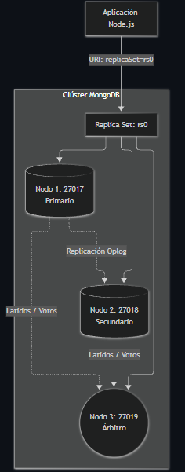
*Explicación: El diagrama muestra la conexión de la aplicación al clúster `rs0`, los tres nodos con sus respectivos roles y la autenticación interna mediante `keyFile`.*

---

## 5. Puesta en marcha

Pasos para levantar el entorno completo desde cero:

1. **Levantar los nodos del Replica Set (`rs0`):**
   Iniciar los tres procesos `mongod` usando la configuración base de `config/mongod.conf` (ajustando puerto y `dbPath` para cada nodo, con `authorization: enabled` y el `keyFile` generado localmente).

2. **Inicializar el Replica Set:**
   Conectarse al nodo principal con `mongosh` y ejecutar `rs.initiate()` agregando el nodo Primario, el Secundario y el Árbitro.

3. **Crear los usuarios (RBAC):**
   * Usuario administrador (`admin` con rol `root` en la base `admin`).
   * Usuario de aplicación con privilegios mínimos (`readWrite` sobre la base de datos `TiendaLD`).

4. **Cargar los datos iniciales (sembrado):**
   ```bash
   mongoimport --uri="mongodb://<usuario>:<password>@localhost:27017,localhost:27018/?replicaSet=rs0&authSource=admin" --db=TiendaLD --collection=productos --file=scripts/data/productos.json --jsonArray
   ```

## 6. Consultas MQL

Las 8 consultas (5 de lectura y 3 de escritura) se encuentran comentadas y listas para ejecutar en `scripts/consultas_crud.js`.

### 1. Filtrado básico por coincidencia exacta
**Problema de negocio:** Listar rápidamente todos los accesorios periféricos disponibles en el catálogo.
```javascript
db.productos.find({ categoria: "Perifericos" });
```
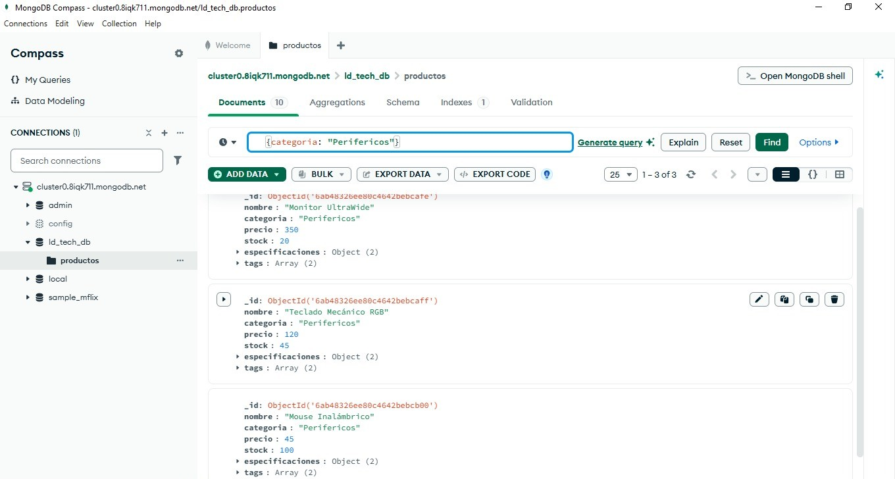
*Explicación: La captura muestra todos los documentos de la colección `productos` cuya categoría coincide exactamente con `"Perifericos"`.*

---

### 2. Operadores de comparación
**Problema de negocio:** Crear un catálogo de regalos "Gama Media", buscando productos que cuesten más de $100 pero hasta $500.
```javascript
db.productos.find({ precio: { $gt: 100, $lte: 500 } });
```
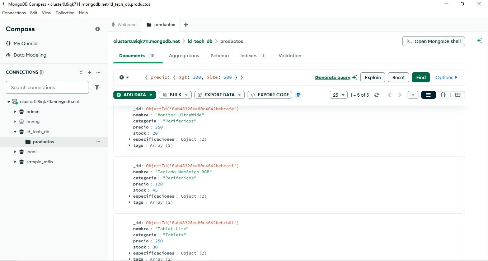
*Explicación: Se filtran los productos dentro del rango de precio especificado utilizando `$gt` y `$lte`.*

---

### 3. Acceso a propiedades anidadas (Dot notation)
**Problema de negocio:** Ver exclusivamente los equipos informáticos que cuentan con 16GB de memoria RAM.
```javascript
db.productos.find({ "especificaciones.ram": "16GB" });
```
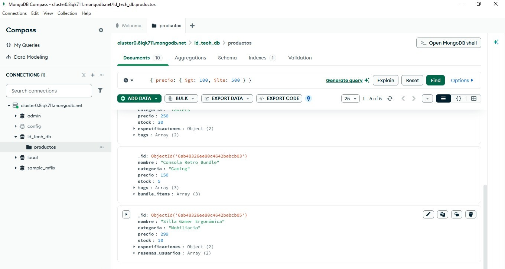
*Explicación: Mediante dot notation se accede al subdocumento `especificaciones` para devolver únicamente los equipos con 16GB de RAM.*

---

### 4. Proyección de campos
**Problema de negocio:** Cargar una lista muy rápida de los precios de los smartphones requiriendo solo el nombre y el precio.
```javascript
db.productos.find({ categoria: "Smartphones" }, { _id: 0, nombre: 1, precio: 1 });
```
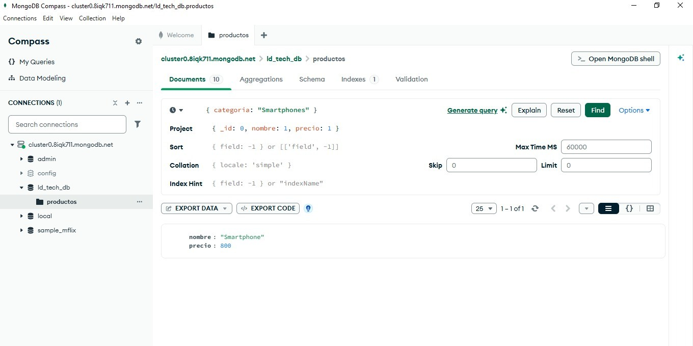
*Explicación: Se excluye `_id` y se proyectan únicamente `nombre` y `precio`, reduciendo el volumen de datos devuelto.*

---

### 5. Filtrado en arreglos
**Problema de negocio:** Encontrar coincidencias exactas seleccionando las etiquetas `"gaming"` y `"teclado"`.
```javascript
db.productos.find({ tags: { $all: ["gaming", "teclado"] } });
```
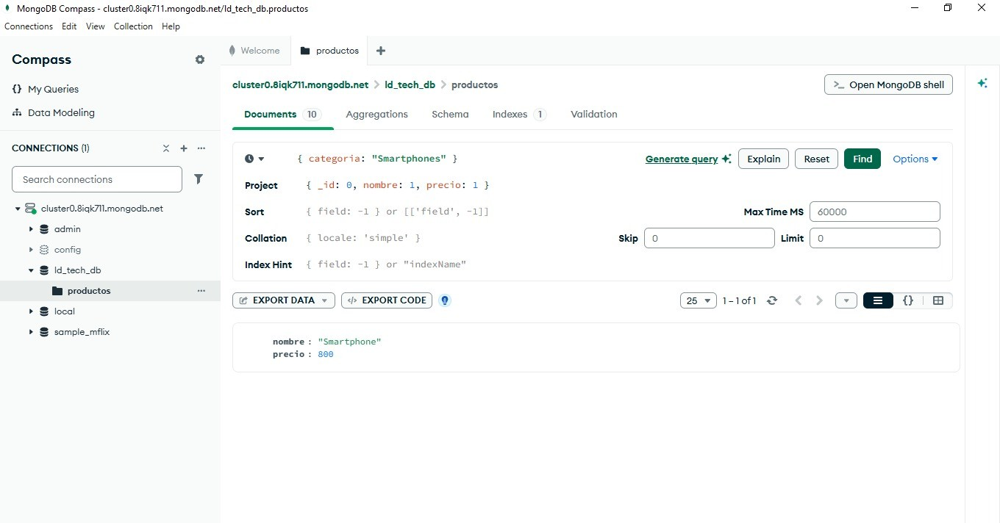
*Explicación: El operador `$all` devuelve únicamente los productos cuyo arreglo `tags` contiene ambas etiquetas simultáneamente.*

---

### 6. Modificación y adición de propiedades (`$set`)
**Problema de negocio:** Poner en descuento la "Tablet Lite", rebajando su precio e indicando que ahora está en promoción.
```javascript
db.productos.updateOne(
  { nombre: "Tablet Lite" },
  { $set: { precio: 220, en_oferta: true } }
);
```
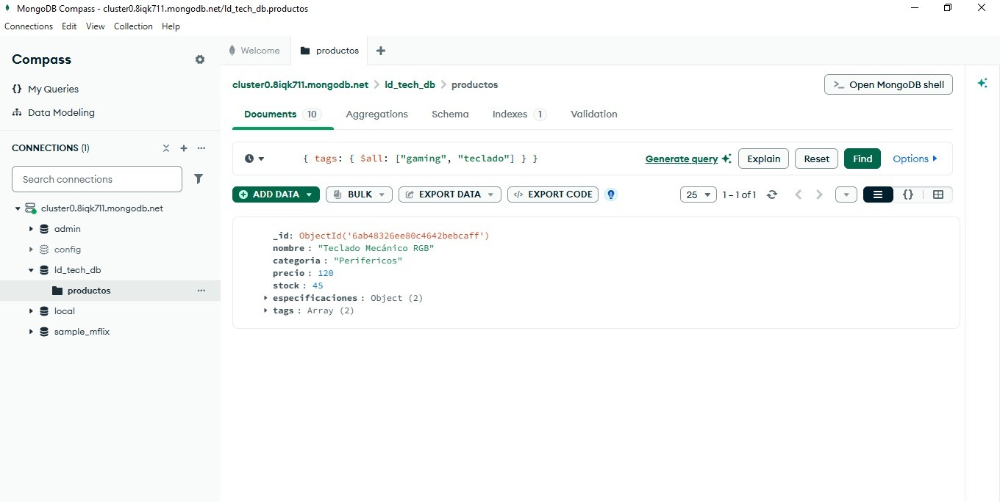
*Explicación: Se actualiza el precio existente y se agrega dinámicamente el campo `en_oferta: true` aprovechando la flexibilidad de esquema.*

---

### 7. Modificación de contadores (`$inc`)
**Problema de negocio:** Descontar 1 unidad del inventario de forma segura tras simular una venta.
```javascript
db.productos.updateOne(
  { nombre: "Laptop" },
  { $inc: { stock: -1 } }
);
```
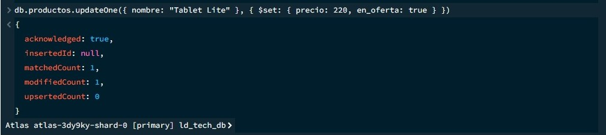
*Explicación: El operador atómico `$inc` decrementa el campo `stock` en 1 unidad sin riesgo de sobrescritura.*

---

### 8. Eliminación bajo filtrado estricto (`deleteOne`)
**Problema de negocio:** Eliminar un accesorio (Cable HDMI) que ya no se va a vender, asegurando que es el lote con más de 150 piezas.
```javascript
db.productos.deleteOne({ nombre: "Cable HDMI 2.1", stock: { $gt: 150 } });
```
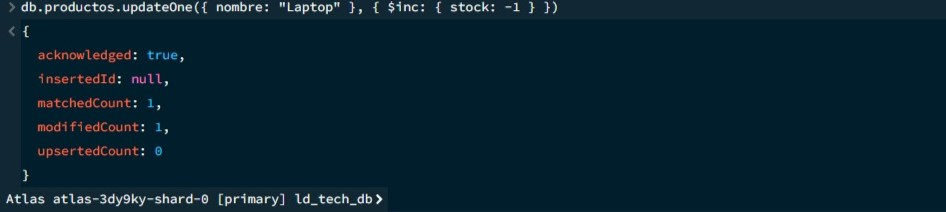
*Explicación: Se confirma la eliminación (`deletedCount: 1`) únicamente cuando coinciden el nombre exacto y la condición de stock mayor a 150.*

## 7. Bitácora del failover

Para validar la Alta Disponibilidad, se desarrolló un script en Node.js (`scripts/failover.js`) que realiza operaciones continuas sobre la colección `productos` cada 2 segundos.

**Proceso de prueba:**
1. **Estado Normal:** El script opera contra el Nodo Primario sin interrupciones.
2. **Simulación de Desastre:** Se apagó abruptamente el servidor del Nodo Primario.
3. **Detección y Votación:** El driver de MongoDB en Node.js detectó la pérdida de conexión y pausó las operaciones temporalmente. En el backend, el Nodo Secundario y el Árbitro emitieron sus votos y promovieron al Secundario como el nuevo Primario.
4. **Recuperación Automática:** En cuestión de segundos, la conexión se restableció automáticamente sin intervención manual, despachando las operaciones encoladas y continuando la ejecución normal.

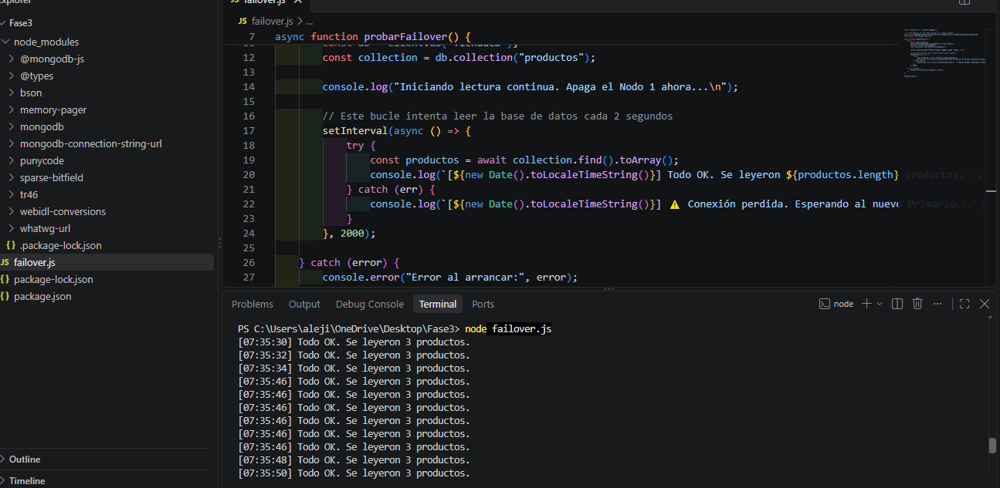
*Explicación: La captura muestra la interrupción momentánea al caer el primario y la reconexión automática sobre el nuevo primario elegido por el clúster.*

---

## 8. Transacción ACID

Script utilizado: `scripts/transaccion.js`.

Para garantizar la atomicidad en los procesos de compra (descuento de stock y registro de venta), se implementó un script con control de sesiones (`startSession` / `startTransaction`). Si alguna de las dos operaciones falla, se ejecuta un *Rollback* (`abortTransaction`) para mantener la base de datos en un estado consistente.

### Escenario de éxito
Se descuenta el stock del producto y se registra la venta dentro de la misma transacción, confirmando los cambios con `commitTransaction()`.

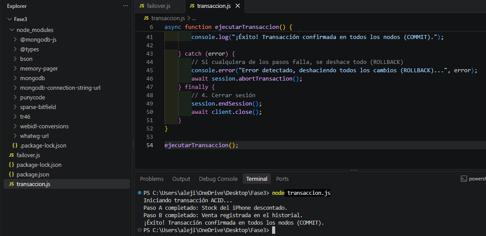
*Explicación: La captura muestra la confirmación exitosa de la transacción y el estado actualizado de las colecciones.*

### Escenario de fallo provocado (Rollback)
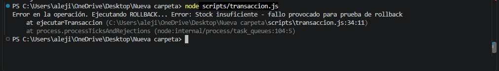
*Explicación: Al producirse un fallo en la validación (por ejemplo, stock insuficiente), la transacción se aborta mediante `abortTransaction()` y no se aplica ningún cambio parcial en la base de datos.*

---

## 9. Reporte de seguridad

Históricamente, muchas bases de datos NoSQL sufrieron vulnerabilidades masivas debido a que los puertos quedaban expuestos a internet sin mecanismos de autenticación por defecto. Para blindar la infraestructura de **TiendaLD**, se aplicó una estrategia de seguridad en dos capas:

1. **Control de Acceso Basado en Roles (RBAC):** Se desactivó el acceso anónimo y se creó un superusuario (`admin`) asignado al rol `root` únicamente para tareas de administración, junto con un usuario de aplicación con privilegios restringidos (`readWrite` solo sobre `TiendaLD`) siguiendo el principio de mínimo privilegio.
2. **Autenticación Interna (Keyfile):** Al tratarse de un Replica Set, se generó un archivo de clave compartida (`keyfile.txt`, excluido del repositorio mediante `.gitignore`) que se pasa al inicializar los demonios de `mongod`. Esto asegura que los tres nodos del clúster estén mutuamente autenticados y rechacen cualquier nodo intruso.

Con esta configuración, la base de datos requiere estrictamente la cadena de conexión autenticada (con `authSource=admin`), bloqueando por completo las conexiones no verificadas.

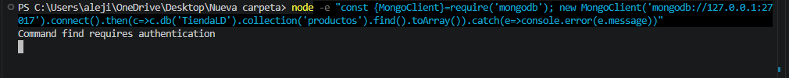
*Explicación: Se comprueba que el acceso sin credenciales es rechazado y que la conexión autenticada funciona correctamente.*
## 10. Conclusiones

A lo largo de las tres fases se consolidó un entorno completo de base de datos NoSQL en producción local: desde el diseño flexible de documentos y consultas MQL avanzadas, hasta la configuración de un Replica Set (`rs0`) con failover automático, transacciones ACID con rollback y seguridad en dos capas (RBAC y `keyFile`).

Como mejoras para una próxima versión del sistema se plantean:
* Crear índices compuestos sobre `categoria`, `precio` y `tags` para optimizar las consultas más frecuentes del catálogo.
* Implementar *sharding* en caso de escalar el volumen de productos y ventas a nivel regional.
* Automatizar backups periódicos (`mongodump`) y exponer las operaciones mediante una API REST con validación de esquemas (`$jsonSchema`).